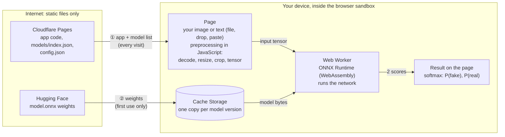

# AI Detection & Forensics Lab

Detect AI-generated images, and inspect images and videos with forensic tools, using models that run **entirely in
your browser**. There is no backend and no account: your files never leave your device.

> [!IMPORTANT]
> **This is a demo.** Every score is a probability computed by a machine-learning model, not proof. Detectors make
> mistakes in both directions, and no detector will ever be perfect. Never use a score as the only basis for a
> decision about a person or a piece of content.

## What it does

| Tab | What it does |
|---|---|
| **Detect** | Runs a detection model on an image (or a text, for text models) and shows the probability of each label. |
| **Image forensics** | Noise (ELA, local variance, high frequency, PRNU demo), color channels (RGB/HSV), edges (Canny, Sobel, LoG), frequency (FFT spectrum, 8×8 block DCT), PCA, EXIF/XMP/IPTC metadata. |
| **Video forensics** | Frame-by-frame motion heatmap, RGB histogram, edges and Lucas–Kanade optical flow, with keyboard stepping. |

An image loaded in Detect is also available in Image forensics, and vice versa. Pasting (Ctrl+V) works on every tab.
The [browser extension](#browser-extension) brings the same detectors to a right-click menu on any website.

## The models

Three image classifiers. Each one answers a single question: was this image generated by AI (`fake`) or not (`real`)?

| Model (folder) | Built on | Size | Input | Reported results |
|---|---|---|---|---|
| **PE-Core Tiny** (`pe_tiny`), the default | Meta's Perception Encoder [PE-Core T16](https://huggingface.co/facebook/PE-Core-T16-384), fine-tuned | 6M parameters, 12.5 MB | RGB, 256×256 | 94.6% balanced accuracy on DeepDetect-25 faces, 92.0% after compression or blur. Catches about 65% of the fakes from the newest generators. |
| **PE-Core Small** (`pe_small`) | Meta's Perception Encoder [PE-Core S16](https://huggingface.co/facebook/PE-Core-S16-384), fine-tuned | 24M parameters, 47 MB | RGB, 256×256 | 93.6% balanced accuracy on DeepDetect-25 faces. Catches about 70% of the fakes from the newest generators. |
| **ResNet-50 6-channel** (`resnet50-6ch`) | ResNet-50 (torchvision architecture), first layer widened to 6 input channels | 25M parameters, 98 MB | RGB, saturation, SRM noise residual and FFT magnitude, 224×224 | 97.8% accuracy (AUC 0.997) on a held-out split of its own training data. Expect much lower accuracy on images from other sources. |

"The newest generators" are GPT-Image-1.5, Nano Banana Pro, Seedream 4.5, Imagen 4 and FLUX.2. All the results are the
author's own measurements, not independent benchmarks.

- **Which one to pick.** `pe_tiny` is the default: the smallest, the fastest, and the most robust to compression.
  `pe_small` catches a few more images from recent generators. `resnet50-6ch` has only been measured on images like
  its training set, so it is the least trustworthy on images found in the wild.
- **Output.** Two raw scores, in the order `fake`, `real`. A softmax turns them into two probabilities that add up
  to 100%.
- **Training data.** Not documented yet. The datasets, with their links and licenses, will be listed here and in the
  model repository.
- **Weights.** Hosted on Hugging Face. Each `public/models/<id>/config.json` holds the exact file URL, and the model
  card there shows how to run the models in Python.

### Licenses and sources

The detectors are fine-tuned from open models and keep the license of the model they come from.

| Detector | Built on | License | Sources |
|---|---|---|---|
| `pe_tiny` | Meta's Perception Encoder, PE-Core T16 | [Apache 2.0](public/models/pe_tiny/LICENSE-pe_tiny.txt) | [weights](https://huggingface.co/facebook/PE-Core-T16-384) · [code](https://github.com/facebookresearch/perception_models) · [paper](https://arxiv.org/abs/2504.13181) |
| `pe_small` | Meta's Perception Encoder, PE-Core S16 | [Apache 2.0](public/models/pe_small/LICENSE-pe_small.txt) | [weights](https://huggingface.co/facebook/PE-Core-S16-384) · [code](https://github.com/facebookresearch/perception_models) · [paper](https://arxiv.org/abs/2504.13181) |
| `resnet50-6ch` | ResNet-50, as implemented in torchvision | [BSD 3-Clause](https://github.com/pytorch/vision/blob/main/LICENSE) | [docs](https://docs.pytorch.org/vision/stable/models/generated/torchvision.models.resnet50.html) · [code](https://github.com/pytorch/vision) · [paper](https://arxiv.org/abs/1512.03385) |

Changes from the original models: trained to detect AI-generated images, with a 2-class output (`fake`, `real`), and
exported to ONNX. `resnet50-6ch` also has its first layer widened to 6 input channels.

## Reading a score

- The page shows the most likely label and the probability of each label. With two labels, the verdict flips at 50%.
- The probability is the model's estimate, based on the patterns it learned. It is not a measurement of your image,
  and it is not calibrated on images like yours: among images scored "95% fake", the actual share of fakes can be
  very different. A model can be very confident and still wrong, especially on images unlike its training data.
- A score close to 50% means the model can't tell. Even 99% can be wrong.
- Mistakes go both ways: real photos flagged as AI-generated (false positives), and AI-generated images passed as
  real (false negatives).
- Scores are less reliable after recompression (social networks do it), resizing, screenshots, crops, filters or
  edits; on images from generators newer than the model; and on subjects unlike the training data. The PE results
  above were measured on faces.
- Models inherit the biases of their training data: image sources, cameras, subjects, and for text models, languages
  and writing styles.
- The forensic views are visual aids to interpret with care, not verdicts.

## Detection is a cat-and-mouse game

A detector learns the traces left by the generators it was trained on: upsampling patterns, frequency artifacts,
textures, color statistics. Each new generator leaves different traces, or fewer, and post-processing can be designed
to remove them. A detector trained before a generator existed therefore misses many of its images. The numbers above
already show it: the PE models reach over 93% balanced accuracy on the benchmark they were measured on, yet miss
about a third of the fakes made by the newest generators. Detectors can only catch up after the fact, once examples
from the new generator are collected and the model is retrained, and then the next generator starts the cycle again.
Expect any detector, these included, to get worse over time unless it is retrained. A `real` result means "no trace
this model knows about", never "authentic".

Provenance is the complementary approach: Content Credentials (C2PA) and IPTC "AI-generated" labels record where an
image comes from, instead of guessing. The extension's **Look closer** panel shows them when a file carries them.
They are easy to strip, though, so their absence proves nothing.

## How local inference works



No arrow goes back to the internet: there is no server to send your image or text to.

1. **Opening the page** downloads the app from Cloudflare Pages (HTML, JavaScript, CSS) and the list of models
   (`models/index.json` and each `config.json`). No model is downloaded yet.
2. **You choose an image or a text.** The browser reads it from your disk or your clipboard.
3. **The first analysis with a model** downloads its `model.onnx` from the URL in its `config.json` (Hugging Face),
   with a progress bar, and keeps it in the browser's Cache Storage. Later analyses and visits load it from there,
   offline too. "Delete downloaded models", under the model picker, clears that cache.
4. **Preprocessing** runs in JavaScript: decode, resize, crop and convert to a tensor, with the same arithmetic as the
   Python code the model was trained with (pixel-exact ports of PIL, torchvision and OpenCV).
5. **Inference**: ONNX Runtime, compiled to WebAssembly, runs the network in a Web Worker, on several threads, so the
   page stays responsive. The current models take 0.2 to 0.7 s per image, even on a single thread.
6. **The result**: a softmax turns the two output scores into probabilities, shown on the page.

### What the page downloads

| What | From | When |
|---|---|---|
| The app: HTML, JavaScript, CSS (about 0.3 MB) | Cloudflare Pages | First visit, then revalidated |
| ONNX Runtime, WebAssembly (about 11 MB) | Cloudflare Pages | First analysis, then kept by the browser |
| `models/index.json` and each `models/<id>/config.json` | Cloudflare Pages | When the Detect tab opens |
| `model.onnx` (12.5, 47 or 98 MB) | Hugging Face, at the URL written in `config.json` | First analysis with that model, then kept in Cache Storage |
| `tokenizer.json` (text models only) | Next to the model's `config.json` | First analysis of a text |
| OpenCV.js (about 11 MB, integrity-checked) | Cloudflare Pages | First use of optical flow, in Video forensics |

That's all. There are no analytics, cookies, ads, web fonts or third-party scripts. The list is fixed by the
deployed files: the page never fetches an address typed by a visitor or found inside a file.

### What never leaves your device

The images, videos and texts you analyze, and the results. There is no server code in this repository and no
address to send them to. Cloudflare and Hugging Face see what any web host sees: your IP address, your browser, and
which files you download. They never see your content.

## Is running models in the browser safe?

Yes, the way this code does it. The page only runs code from this repository's build, a model file is data rather
than code, and everything runs inside the browser's sandbox.

**A model file can't run code.** The well-known danger with downloaded models is Python's pickle format: `torch.load`
on a `.pt`, `.pth`, `.bin` or `.ckpt` file can execute code hidden inside it. This project never uses that format.

| Format | What loading it does | Used here |
|---|---|---|
| PyTorch pickle (`.pt`, `.pth`, `.bin`, `.ckpt`) | Can execute arbitrary Python code hidden in the file | No |
| ONNX (`.onnx`) | Reads a graph of standard math operations (convolutions, matrix products, softmax…) and its weights | **Yes** |
| safetensors | Reads raw tensors | No |

**Several walls stand between a model and your computer.**

- ONNX Runtime is compiled to WebAssembly and runs in a Web Worker, inside the browser's sandbox: it has no access to
  your files, your other tabs or other sites. A model has no operation that could make a network request.
- ONNX Runtime Web can't load custom operator libraries. The three shipped models were checked: standard ONNX
  operators only, no external data files, no embedded metadata.
- Images are decoded by the browser's own decoders, the same ones that display images on any web page. Metadata
  (EXIF, XMP, IPTC) is displayed as plain text: the code never injects HTML.
- OpenCV.js is served by the site itself and checked with Subresource Integrity.

**What could still go wrong, and what limits it.**

- **The model host is trusted.** Visitors run whatever file sits at the URL in `config.json`. If the Hugging Face
  account were taken over, an attacker could swap a model. Visitors would get wrong scores or a crashed tab, not code
  running on their computer. Limit it with two-factor authentication on Hugging Face, and with URLs pinned to a commit
  (`/resolve/<commit>/…` rather than `/resolve/main/…`), so a file can't change under the site.
- **Bugs in ONNX Runtime.** A crafted model could target a parsing bug. In the browser, such a bug stays inside the
  WebAssembly sandbox: escaping it would take a separate browser exploit. Keep `onnxruntime-web` up to date.
- **npm dependencies** are bundled into the site at build time, as in any web app. The lockfile pins them, and there
  are only five runtime dependencies.
- **Resource use.** Models run on the visitor's processor and memory. The 98 MB model can be slow on a phone.
- **The browser extension** can do more than the page: it can download images from any site. It only does so for the
  image you right-click or drag into it, with your cookies so that images behind a sign-in work. The image is
  analyzed in the panel and sent nowhere.

## Hosting and traffic

The site is only static files, so a traffic spike isn't a problem, and there is nothing to queue.

- **Cloudflare Pages** serves the app. Requests for static files are free and unlimited on every plan. Only Pages
  Functions are metered, and this site has none. The limits that matter are 25 MiB per file and 20,000 files per site
  (free plan), which is why the weights live on Hugging Face.
- **Hugging Face** serves the weights from its CDN. Each visitor downloads a model once, anonymously, from their own
  IP address, and then the browser keeps it. Hub rate limits for anonymous downloads apply per IP address (3,000 file
  requests per 5 minutes as of September 2025), so they limit each visitor, not the site.
- **Inference costs you nothing.** It runs on each visitor's own device: ten visitors or a hundred thousand cost the
  same.
- **What a visit costs** is the visitor's data and battery: 12.5 MB for the default model, up to 98 MB for the
  largest, downloaded once.

A queue only becomes necessary if a model runs on a server you pay for, for example a model too large for browsers,
on a Hugging Face Space or a GPU endpoint. Gradio has a queue built in; add rate limiting or a captcha (such as
Cloudflare Turnstile) in front of it.

## Run locally

```sh
npm install
npm run dev          # http://localhost:8080
npm run build        # static site in dist/
npm run typecheck
npm run lint
```

Model weights are not in git (`*.onnx` is gitignored). When a `config.json` points to Hugging Face, the dev server
downloads the weights from there. To work offline or try a new model, put the file at `public/models/<id>/model.onnx`
and set `"model": "model.onnx"`.

## Deploy: Cloudflare Pages and Hugging Face

1. Upload each model folder to a Hugging Face model repository (`pe_tiny/model.onnx`, `pe_small/model.onnx`,
   `resnet50-6ch/model.onnx`), with the model card and the license.
2. In each `public/models/<id>/config.json`, set `"model"` to the file's URL, pinned to a commit:

   ```json
   "model": "https://huggingface.co/<user>/<repo>/resolve/<commit>/pe_tiny/model.onnx"
   ```

   Hugging Face sends the CORS headers the page needs. Any other host must send `Access-Control-Allow-Origin`.
3. Create a Cloudflare Pages project from the GitHub repository, with build command `npm run build` and output
   directory `dist`. A build from git contains no weights, since they are gitignored.
4. Open the site: the first analysis downloads the model with a progress bar. In the browser's developer tools
   (Network tab), requests should only go to your domain, `huggingface.co` and `*.hf.co`.

- `npx wrangler pages deploy dist` uploads a local build instead, as long as `public/` holds no weights: Cloudflare
  rejects files larger than 25 MiB.
- `public/_headers` sets the cross-origin isolation headers that let ONNX Runtime use several threads. Keep it.
- `Dockerfile`, `nginx.conf` and `nixpacks.toml` are for self-hosting with Docker and nginx. Cloudflare ignores them.

## Add a model

Every model plugs in the same way, without code: a folder with a `config.json`, and an ONNX file in that folder or
at a URL.

1. Export it to ONNX (one graph from input tensor to class scores).
2. Create `public/models/<id>/` with a `config.json`, and `model.onnx` unless `config.json` gives a URL. Text models
   also need `tokenizer.json` and `tokenizer_config.json`.
3. Add `"<id>"` to `public/models/index.json`. The first entry is the default model.

Reload the page. If a config is wrong, the page shows which file and why.

### config.json

```json
{
  "name": "ResNet-50 6-channel forensic",
  "description": "Shown under the model picker.",
  "task": "image",
  "version": "1",
  "model": "model.onnx",
  "labels": ["fake", "real"],
  "output": "logits",
  "preprocess": [
    { "op": "resize", "size": [224, 224], "filter": "bicubic" },
    { "op": "forensic6" }
  ]
}
```

| Field | Meaning |
|---|---|
| `task` | `"image"` or `"text"`, which decides the input shown on the page. |
| `labels` | Class names **in the order of the model output** (ImageFolder sorts folders: `fake`=0, `real`=1). |
| `output` | `"logits"` (softmax is applied, the default), `"probs"` (already probabilities) or `"sigmoid"` (one raw score, gives P(`labels[1]`)). |
| `preprocess` | Steps applied in order, see below. |
| `model` | ONNX file relative to the folder, or an absolute URL (see [Deploy](#deploy-cloudflare-pages-and-hugging-face)). Default `model.onnx`. |
| `version` | Change it whenever you replace the model file: browsers keep a downloaded model per URL and version. The PE models use the first 12 hex digits of the file's SHA-256. |

The app feeds the model's **first input** and reads its **first output**, whatever their names. Batch size is 1.

### Preprocessing ops

Each op reproduces its Python counterpart exactly (verified pixel for pixel against PIL, torchvision, OpenCV and
Hugging Face tokenizers), so translate your **eval** transform line by line. Sizes are `[height, width]`.

| op | Python equivalent |
|---|---|
| `{"op": "resize", "size": 256}` | `transforms.Resize(256)`: shorter side to 256 |
| `{"op": "resize", "size": [224, 224], "filter": "bicubic"}` | `img.resize((224, 224), Image.BICUBIC)`. Filters: `bilinear` (default, as torchvision), `bicubic` (default of PIL `Image.resize`), `lanczos` |
| `{"op": "center_crop", "size": 224}` | `transforms.CenterCrop(224)` |
| `{"op": "to_tensor"}` | `transforms.ToTensor()` |
| `{"op": "normalize", "mean": [...], "std": [...]}` | `transforms.Normalize(mean, std)` |
| `{"op": "forensic6"}` | 6 channels: RGB, HSV saturation, SRM noise residual, FFT log-magnitude (exact formulas in `src/lib/preprocess/forensic6.ts`) |
| `{"op": "tokenize", "max_length": 512}` | `tokenizer(text, truncation=True, max_length=512)` |

The standard torchvision ImageNet eval transform (resnet50, vit_b_16, mobilenet_v3_small, dinov2) becomes:

```json
"preprocess": [
  { "op": "resize", "size": 256 },
  { "op": "center_crop", "size": 224 },
  { "op": "to_tensor" },
  { "op": "normalize", "mean": [0.485, 0.456, 0.406], "std": [0.229, 0.224, 0.225] }
]
```

A new kind of preprocessing is one function in `src/lib/preprocess/` and one `case` in `preprocessImage`.

### Text models

The pipeline supports text detectors, although none is shipped in this deployment.

- Tokenizer: `AutoTokenizer.from_pretrained(base).save_pretrained("public/models/<id>")` writes `tokenizer.json` and
  `tokenizer_config.json`. `config.json` gets `"preprocess": [{ "op": "tokenize", "max_length": 512 }]`.
- ONNX inputs are named `input_ids` and `attention_mask` (and optionally `token_type_ids`): int64, shape `[1, seq]`.
- Put everything after the tokenizer in the graph: layer choice, pooling, normalization and the classifier.
  For an embedding + logistic regression detector (verified with transformers 4.57 and torch 2.6; with
  transformers 5.4 `torch.onnx.export` fails while tracing the attention mask, so export with `transformers<5`):

```python
import torch
from transformers import AutoModel, AutoTokenizer

BASE, LAYER, OUT = "sentence-transformers/all-MiniLM-L6-v2", 2, "public/models/minilm-lr"
AutoTokenizer.from_pretrained(BASE).save_pretrained(OUT)

class Detector(torch.nn.Module):
    def __init__(self, clf):  # the fitted sklearn LogisticRegression
        super().__init__()
        self.encoder = AutoModel.from_pretrained(BASE)
        self.head = torch.nn.Linear(clf.coef_.shape[1], 1)
        with torch.no_grad():
            self.head.weight.copy_(torch.from_numpy(clf.coef_))
            self.head.bias.copy_(torch.from_numpy(clf.intercept_))

    def forward(self, input_ids, attention_mask):
        h = self.encoder(input_ids=input_ids, attention_mask=attention_mask,
                         output_hidden_states=True).hidden_states[LAYER]
        m = attention_mask.unsqueeze(-1).to(h.dtype)
        x = (h * m).sum(1) / m.sum(1)              # same pooling as in training
        x = x / x.norm(dim=-1, keepdim=True)       # same normalization as in training
        return self.head(x)                        # one logit: "output": "sigmoid", "labels": ["human", "ai"]

ids = torch.ones(1, 8, dtype=torch.long)
torch.onnx.export(Detector(clf).eval(), (ids, ids), f"{OUT}/model.onnx",
                  input_names=["input_ids", "attention_mask"], output_names=["logits"],
                  dynamic_axes={"input_ids": {1: "seq"}, "attention_mask": {1: "seq"}}, opset_version=17)
```

Text models exported this way (not included in this repository), each checked against the Python detector it came
from:

| Example folder (size) | Notes |
|---|---|
| `julia1-jev` (196 MiB) | Julia 1, a Jev-like zero-shot decision model. The question and its option markers are constants inside the graph, so the page only tokenizes the text (its `tokenizer.json` appends `<eos>` only). |
| `e5-small-raid` (37 MiB) | An off-the-shelf fine-tuned classifier, e.g. RAID-trained detectors. |
| `minilm-l2-last-ocsvm` (18 MiB) | A custom-trained detector: encoder layer, pooling, scaler, PCA and LR / one-class SVM, all in the graph. |

Weights are int8 per block of 32 (weight-only, standard ONNX ops), so activations stay fp32.
`onnxruntime.quantization.quantize_dynamic` is not used: it also quantizes activations, which breaks BERT-family
encoders (Julia 1 lost all ranking with it). The three example folders were run through this app's
onnxruntime-web (WebAssembly) and tokenizers.js with `scripts/run-text-model.mjs`. They gave the same token ids
as Python, and probabilities within 1e-5. Their outputs are calibrated so that 50% flags 5% of reference human
texts: off-the-shelf detectors are overconfident on human text from new domains.

### Check a new model

Run your Python eval on one image (or text) and compare with the page: the percentages must agree to 0.1%.
If they don't, `preprocess` doesn't describe your eval transform, or `labels` / `output` are wrong.

Text models can be checked without a browser. `node scripts/run-text-model.mjs public/models/<id> texts.json`
runs the folder with the app's own onnxruntime-web and tokenizers.js, and prints P(label) per text (texts.json
is a JSON array of strings).

## Code map

```
src/main.tsx                   routes: /legal and /legal-en (plus aliases) show the legal notice, anything else the app
src/App.tsx                    the tabs
src/components/                Detector, ImageForensics, VideoForensics, small UI pieces
src/pages/                     legal notice, in French and English
src/lib/types.ts               the model contract (ModelConfig, preprocessing ops)
src/lib/registry.ts            reads models/index.json and each config.json, validates them
src/lib/inference.ts           ONNX Runtime session, input tensors, output → probabilities
src/lib/modelFiles.ts          downloads model files once, keeps them in Cache Storage per URL and version
src/lib/preprocess/image.ts    decoding + PIL-exact resize, center crop, to_tensor, normalize
src/lib/preprocess/forensic6.ts  6-channel forensic input (OpenCV/SciPy/NumPy-exact)
src/lib/preprocess/text.ts     Hugging Face tokenizer (tokenizers.js) with Python-style truncation
src/lib/fft.ts                 FFT of any size (model preprocessing and the spectrum view)
src/lib/forensics/image.ts     image forensics views (pure functions: pixels in, pixels out)
src/lib/forensics/video.ts     video frame views (heatmap, histogram, edges, optical flow)
src/lib/opencv.ts              loads OpenCV.js on demand (optical flow only)
src/lib/links.ts               REPO_URL, the GitHub link in the header and the extension (no link while empty)
public/models/                 index.json and one folder per model
public/_headers                response headers for Cloudflare Pages
scripts/run-text-model.mjs     runs a text model with the app's runtime, without a browser
extension/                     the browser extension, built from src/
```

- ONNX Runtime (WebAssembly) runs in a web worker, on several threads. Threads need the page to be cross-origin
  isolated, so `vite.config.ts`, `nginx.conf` and `public/_headers` (Cloudflare Pages) send
  `Cross-Origin-Opener-Policy: same-origin` and `Cross-Origin-Embedder-Policy: require-corp`. Keep them if another
  host serves the site.
- OpenCV.js (11 MB, `public/opencv/`) is pinned to 4.11 and checked with a Subresource Integrity hash. Everything
  else is bundled.

## Browser extension

`extension/` builds a Chrome, Brave, Edge and Firefox extension from this code and these models: right-click any
image on any site (Instagram included) to check it in a side panel. See [extension/README.md](extension/README.md).

## Credits

- **Models**: see [Licenses and sources](#licenses-and-sources).
- **ONNX Runtime Web**: MIT License
- **Tokenizers.js** (Hugging Face): Apache-2.0 License
- **OpenCV.js** (via @techstark/opencv-js): Apache-2.0 License
- **exifr**: MIT License
- **React**: MIT License
- **Favicon**: magnifying glass from [SVG Repo](https://www.svgrepo.com/) (Responsive Flat Icons, pixelbazaar, CC Attribution)
